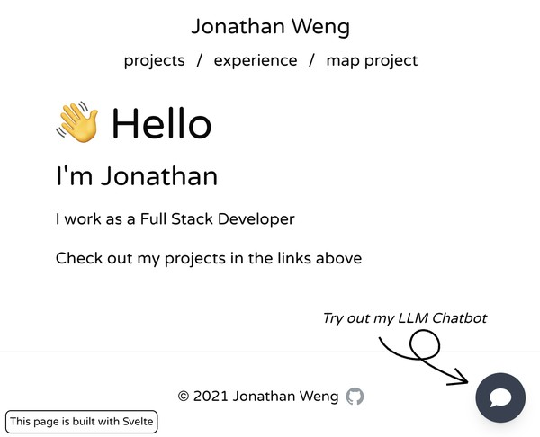
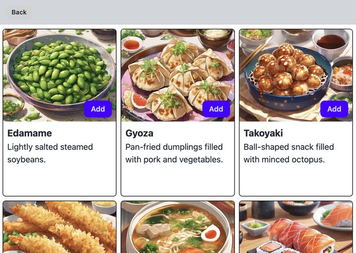

Hi, I'm Jonathan

List of my past university projects:
- [CS3103](https://github.com/jonathanwj/CS3103_P2P), NUS P2P Networking Project with NAT handling, written in C++.
- [CS2103T](https://github.com/jonathanwj/CS2103T-VetterAppointments-F09-B4), NUS Software Engineering project, a Address Book desktop application, written in Java.

Checkout some of my personal projects below:

|   |   |
|---|---|
| [Portfolio](https://jonweng.com)   Personal Portfolio with a LLM chatbot  |   |
| [Food Menu Demo](https://food.jonweng.com)   A demo app for lazy loading   images with blurhash. It's built in Svelte. |  |

<!--
**jonathanwj/jonathanwj** is a ✨ _special_ ✨ repository because its `README.md` (this file) appears on your GitHub profile.

Here are some ideas to get you started:

- 🔭 I’m currently working on ...
- 🌱 I’m currently learning ...
- 👯 I’m looking to collaborate on ...
- 🤔 I’m looking for help with ...
- 💬 Ask me about ...
- 📫 How to reach me: ...
- 😄 Pronouns: ...
- ⚡ Fun fact: ...
-->
